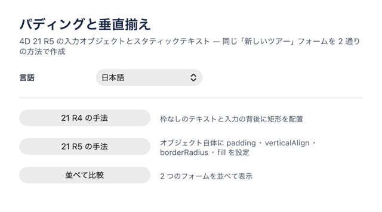
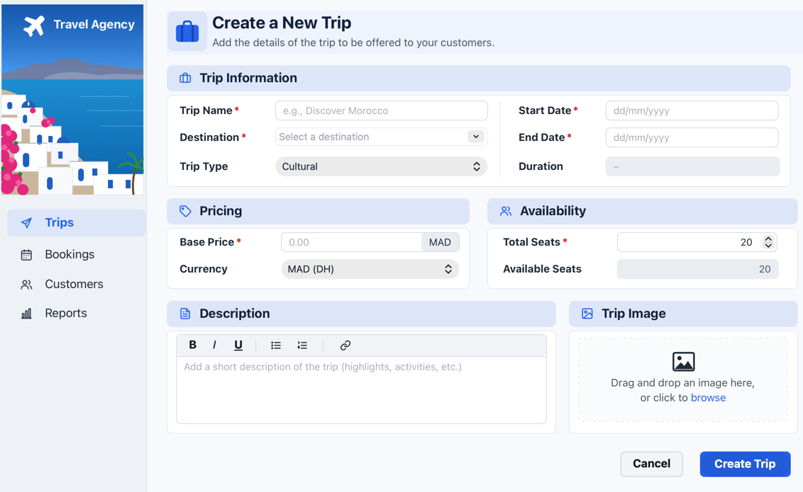
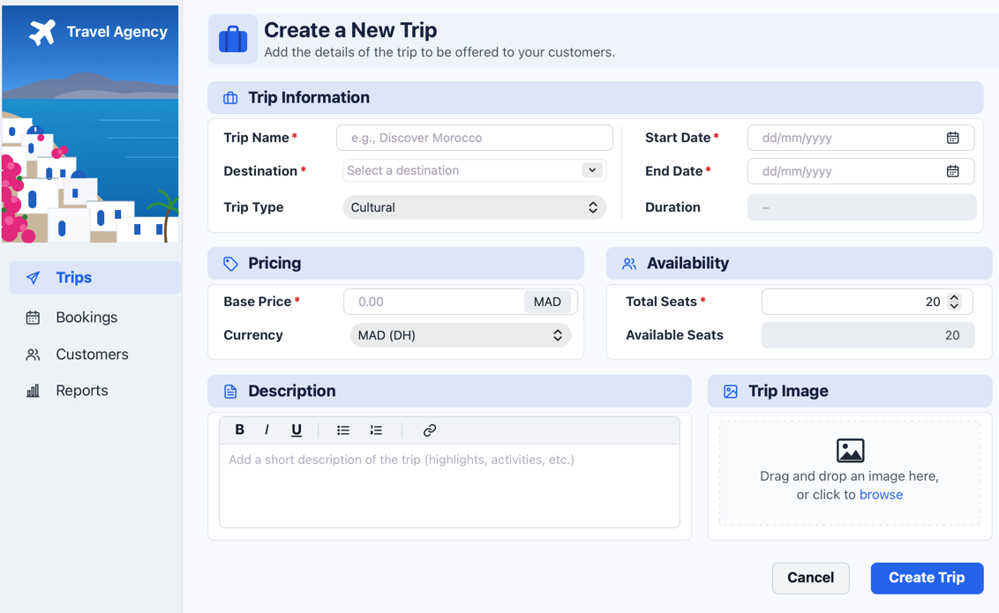
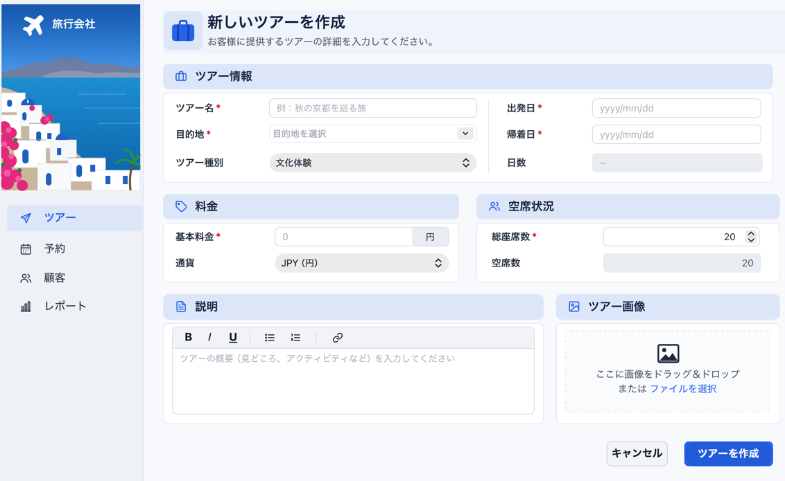
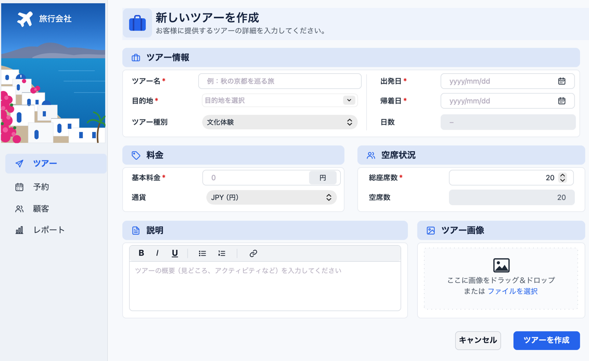

# Webinar_PaddingVerticalAlign_InputStaticText

[English](#english) | [日本語](#日本語)



---

## English

A 4D 21 R5 webinar demo. It shows the new **padding** and **vertical alignment** properties of Input and Static Text objects by building the same "New Trip" form twice:

| Form | Technique |
|---|---|
| `NewTrip_21R4` | Borderless texts and inputs placed on top of rectangles. The rectangle draws the box; the object only holds the text. |
| `NewTrip_21R5` | No rectangles. `paddingLeft`, `verticalAlign`, `borderRadius`, `fill` and a solid border are set on the text or input itself. |

The two forms look the same. Open them in the Form Editor to compare how they are built.

### Requirements

- 4D 21 R5 or later.
- The screenshots were taken on macOS with the Liquid Glass theme.

### How to use

1. Open `Project/Webinar_PaddingVerticalAlign_InputStaticText.4DProject` in 4D. There is no data file in the repository: let 4D create one.
2. The launcher opens automatically. You can also open it with **File > Demo Launcher…** (⌘L / Ctrl+L).
3. Click **21 R4 technique**, **21 R5 technique** or **Compare side by side**.
4. The UI follows the OS language (English or Japanese). Use the **Language** menu in the launcher to switch: open demo windows close and reopen in the same place in the new language.

### Points to notice

- **Outsets.** In 21 R5, a filled text with `borderRadius` r is drawn r pixels wider on each side. An input with a solid border and radius r is drawn r+1 pixels wider and 1 pixel taller. The 21 R5 form therefore insets those objects to stay aligned with the 21 R4 layout.
- **Custom buttons.** The Cancel and Create Trip buttons are `style: custom` buttons with `borderStyle: custom`, so their `borderFillColor`, `borderColor` and `borderRadius` are painted, including under Liquid Glass. Without `borderStyle: custom` the colours are ignored.
- **One class for both forms.** Both form methods call `cs.NewTripForm.new().handle(FORM Event)`, so the runtime behaviour is identical and only the layout differs.
- **Localisation.** All strings are in `Resources/en.lproj` and `Resources/ja.lproj`. Choice lists (destinations, trip types, currencies) are pipe-separated XLIFF strings, and the currency sets the unit and decimals (JPY has none).

### Project structure

```
Project/Sources/
  Classes/NewTripForm.4dm          shared logic for both New Trip forms
  Forms/Launcher/                  demo launcher (language switch, open buttons)
  Forms/NewTrip_21R4/              21 R4 technique: rectangles behind objects
  Forms/NewTrip_21R5/              21 R5 technique: padding / verticalAlign / borderRadius
  Methods/Start.4dm                opens the launcher (On Startup, File menu)
  Methods/Demo_*.4dm               window helpers: open, side by side, language switch
  styleSheets.css                  launcher styles
Resources/en.lproj, ja.lproj       XLIFF strings
docs/images/                       screenshots
```

### Screenshots

| 21 R4 technique | 21 R5 technique |
|---|---|
|  |  |

---

## 日本語

4D 21 R5 のウェビナー用デモです。入力オブジェクトとスタティックテキストに追加された **パディング** と **垂直揃え** のプロパティを、同じ「新しいツアー」フォームを 2 通りの方法で作成して紹介します。

| フォーム | 手法 |
|---|---|
| `NewTrip_21R4` | 枠なしのテキストと入力を矩形の上に配置。枠は矩形が描画し、オブジェクトは文字だけを表示します。 |
| `NewTrip_21R5` | 矩形は使いません。`paddingLeft`・`verticalAlign`・`borderRadius`・`fill`・実線の枠線をテキストや入力そのものに設定します。 |

2 つのフォームの見た目は同じです。フォームエディターで開いて、作り方の違いを比べてください。

### 動作環境

- 4D 21 R5 以降
- スクリーンショットは macOS（Liquid Glass テーマ）で撮影しています。

### 使い方

1. 4D で `Project/Webinar_PaddingVerticalAlign_InputStaticText.4DProject` を開きます。リポジトリにはデータファイルが含まれていないので、4D で新規作成してください。
2. ランチャーが自動的に開きます。**ファイル > デモランチャー…**（⌘L / Ctrl+L）からも開けます。
3. **21 R4 の手法**、**21 R5 の手法**、**並べて比較** のいずれかをクリックします。
4. 表示言語は OS の言語（英語または日本語）に従います。ランチャーの **言語** メニューで切り替えると、開いているデモウインドウは同じ位置で新しい言語で開き直されます。

### 注目ポイント

- **はみ出し。** 21 R5 では、塗りつぶしと `borderRadius` r を設定したテキストは左右に r ピクセル広く描画されます。実線の枠線と角丸 r を設定した入力は、左右に r+1 ピクセル、上下に 1 ピクセル広く描画されます。そのため 21 R5 のフォームでは、21 R4 のレイアウトと揃うようにこれらのオブジェクトを内側に配置しています。
- **カスタムボタン。** キャンセルとツアー作成のボタンは `style: custom` と `borderStyle: custom` を設定したボタンです。これにより Liquid Glass でも `borderFillColor`・`borderColor`・`borderRadius` が描画されます。`borderStyle: custom` がないと色の設定は無視されます。
- **2 つのフォームで 1 つのクラス。** どちらのフォームメソッドも `cs.NewTripForm.new().handle(FORM Event)` を呼び出すので、動作は同じでレイアウトだけが異なります。
- **ローカライズ。** 文字列はすべて `Resources/en.lproj` と `Resources/ja.lproj` にあります。選択リスト（目的地・ツアー種別・通貨）は XLIFF の文字列をパイプ（|）で区切って定義し、通貨に合わせて単位と小数桁を切り替えます（JPY は小数なし）。

### プロジェクト構成

```
Project/Sources/
  Classes/NewTripForm.4dm          2 つのフォームで共有するロジック
  Forms/Launcher/                  デモランチャー（言語切り替え・各ボタン）
  Forms/NewTrip_21R4/              21 R4 の手法：オブジェクトの背後に矩形
  Forms/NewTrip_21R5/              21 R5 の手法：padding / verticalAlign / borderRadius
  Methods/Start.4dm                ランチャーを開く（開始時・ファイルメニュー）
  Methods/Demo_*.4dm               ウインドウ操作：表示・並べて表示・言語切り替え
  styleSheets.css                  ランチャーのスタイル
Resources/en.lproj, ja.lproj       XLIFF 文字列
docs/images/                       スクリーンショット
```

### スクリーンショット

| 21 R4 の手法 | 21 R5 の手法 |
|---|---|
|  |  |
